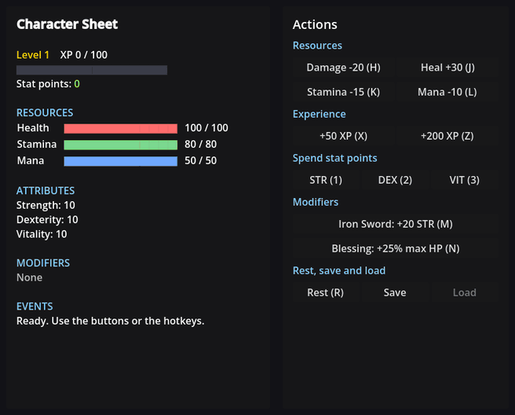
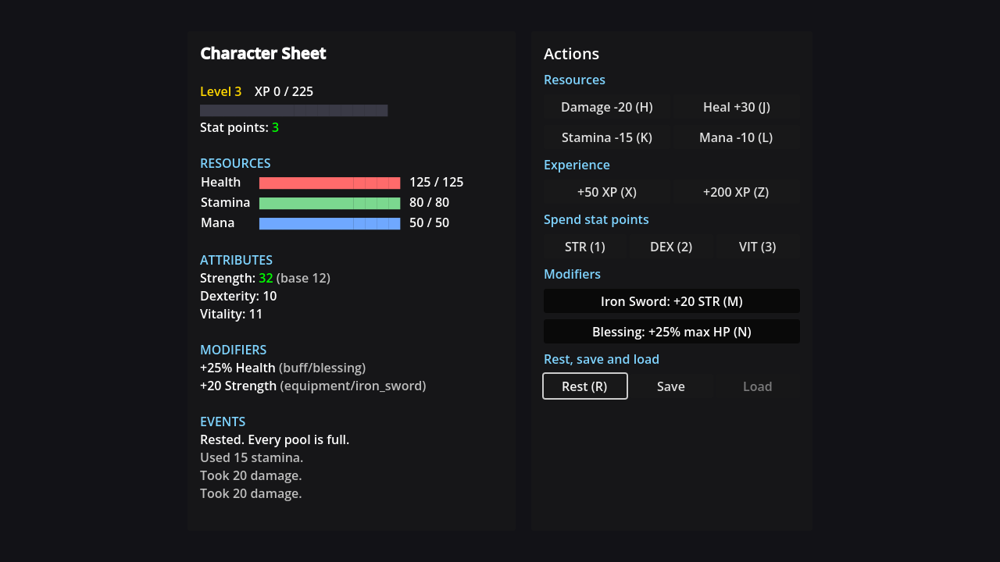

# Godot Stats & Leveling

Reusable RPG stats and XP leveling components for Godot 4: health and mana pools,
attributes, flat and percent modifiers you can tag by source, and a level curve
with stat points to spend.



## Features

- **`Stat` resource:** a base value, a min and max, a current value, and
  `value_changed` and `depleted` signals.
- **Pools and attributes.** Health, stamina and mana are pools you spend and
  refill. Strength, dexterity and the rest are attributes. `get_value()` returns
  the right number for each: a pool's live value, or an attribute's fully
  modified value.
- **Source-tagged modifiers.** `set_modifier(&"strength", &"equipment/iron_sword", 20)`
  adds a bonus you can remove later by name, without touching any other bonus.
  Setting the same source twice replaces it instead of stacking.
- **Clear by source or by category:** `clear_source(&"equipment/iron_sword")`
  takes one item off every stat it touched, and
  `clear_modifiers_from_prefix("buff/")` wipes a whole category.
- **Flat and percent:** `(base + flat) * (1 + percent)`, so a +25% blessing scales
  your gear too.
- **`StatsComponent`:** attach it to any character. Each instance duplicates its
  stat definitions, so enemies sharing one `.tres` never share health.
- **`LevelingComponent`:** an exponential XP curve, several level-ups from one
  big XP gain, stat points per level, and per-stat point costs.
- **Save and load:** `get_stats_snapshot()` and `get_save_data()` return plain
  dictionaries you can write to disk.
- **`StatPresets`:** ready-made stat sets (souls-like, simple RPG, action,
  survival, minimal).

## Demo



`World.tscn` is a character sheet. The right panel has buttons for damage,
healing, XP, spending points, two modifiers (an iron sword and a blessing), rest,
save and load. Every button also has a hotkey, shown in brackets.

## Requirements

- Godot **4.7** or later, standard build (GDScript only, no .NET needed).
- Tested on **Godot 4.7.2 stable** on Windows. Earlier 4.x versions are untested.
- Uses the Compatibility renderer, so it runs on older GPUs too.

## Installation

Clone the repository:

```bash
git clone https://github.com/CodingQuests/godot-stats-leveling.git
```

Or download it with **Code > Download ZIP** and unzip it.

Then open Godot, click **Import**, pick the `project.godot` file inside the folder,
and click **Import & Edit**.

## Quick Start

1. Press **F5**.
2. Click **+200 XP** to level up, then spend the points on **STR**, **DEX** or
   **VIT**.
3. Toggle the **Iron Sword** and watch Strength go up by 20, then come back down.
4. Toggle the **Blessing**, then **Rest**: max health grows by 25% and the pool
   fills to the new max.
5. Click **Save**, change some things, then **Load**.

## How It Works

### One stat

A `Stat` keeps a base value and a list of modifiers, and works out its maximum
from them:

```gdscript
var max_computed: float:
	get:
		var flat := _flat_modifiers
		var percent := _percent_modifiers
		for mod: Dictionary in _mods.values():
			flat += mod.get("flat", 0.0)
			percent += mod.get("percent", 0.0)
		return clampf((base_value + flat) * (1.0 + percent), min_value, max_value)
```

`current_value` clamps itself between `min_value` and that maximum, and emits
`depleted` when it hits the bottom.

### Pools and attributes

A pool (health, stamina, mana) is spent and refilled, so its value is
`current_value`. A +25% max health buff raises the ceiling, not the health you have
right now. An attribute (strength, defense) is never spent, so its value is its
modified maximum. A +20 strength sword counts the moment you equip it.

`StatsComponent.get_value()` makes that distinction for you, using the exported
`pool_stats` list. Add your own pool, like `&"energy"`, to that list in the
Inspector.

### Modifiers with a source

```gdscript
# Equip
stats.set_modifier(&"strength", &"equipment/iron_sword", 20.0)
stats.set_modifier(&"defense", &"equipment/iron_sword", 5.0)

# Unequip: one call takes it off every stat it touched
stats.clear_source(&"equipment/iron_sword")

# A +25% buff, then the end of a run wiping every buff
stats.set_modifier(&"health", &"buff/blessing", 0.0, 0.25)
stats.clear_modifiers_from_prefix("buff/")
```

The older `add_flat_modifier()` and `add_percent_modifier()` still work for a
quick unnamed bonus, but you have to remember the exact amount to remove it.

### Levelling

`LevelingComponent` needs `stats_component_path` pointing at its sibling
`StatsComponent`. XP to reach the next level is
`base_xp_requirement * xp_scaling_factor ^ (level - 2)`, so with the defaults level
2 needs 100 XP, level 3 needs 150 and level 4 needs 225. `add_xp()` loops, so one
big reward can grant several levels. `spend_stat_point()` raises a stat's base
value permanently.

## Project Structure

```
project.godot                     Project file
World.tscn                        The demo: a character sheet and an actions panel
Scripts/stat.gd                   One stat: base, min, max, current, modifiers
Scripts/stats_component.gd        A character's set of stats, and the modifier API
Scripts/leveling_component.gd     XP, levels and stat points
Scripts/stat_presets.gd           Ready-made stat sets
Scripts/example_player.gd         Demo only: buttons, hotkeys and the character sheet
```

## Using It In Your Own Game

1. Copy `stat.gd`, `stats_component.gd` and `leveling_component.gd` (and
   `stat_presets.gd` if you want the presets).
2. Add a `StatsComponent` node to your character and fill in `stat_definitions`,
   either in the Inspector with `Stat` resources or in code:

   ```gdscript
   stats.stat_definitions = StatPresets.get_soulslike_stats()
   stats._initialize_stats()
   ```

3. Add a `LevelingComponent` next to it and set `stats_component_path` to the
   `StatsComponent`.
4. Use it:

   ```gdscript
   stats.modify_value(&"health", -20.0)       # take damage
   var damage := 5.0 + stats.get_value(&"strength") * 0.5
   leveling.add_xp(40)                        # on a kill
   stats.stat_depleted.connect(func(stat_name):
   	if stat_name == &"health":
   		die()
   )
   ```

## Customizing It

- **XP curve:** `base_xp_requirement`, `xp_scaling_factor`, `max_level` and
  `stat_points_per_level` on the `LevelingComponent`.
- **Expensive stats:** `leveling.set_stat_cost(&"luck", 2)`.
- **Your own pools:** add names to `pool_stats` on the `StatsComponent`.
- **New stats at runtime:** `stats.ensure_stat(&"crit_chance", 5.0)` adds a stat
  only if it is not there yet.
- **Presets:** add your own static function to `stat_presets.gd` that returns an
  `Array[Stat]`.

## Known Limitations

- Snapshots save base and current values, level, XP and points. Modifiers are not
  saved: re-apply them from your equipment and buffs when you load.
- `_initialize_stats()` builds the stats. It runs in `_ready()`; call it again
  yourself if you set `stat_definitions` in code afterwards, as the demo does.
- Stat points always add 1 to the base value. Spending a point on vitality does
  not also raise health; connect `stat_point_spent` if you want derived stats.
- The demo is a UI panel, not a game scene.
- Tested on Godot 4.7.2 on Windows only.

## License

MIT. See [LICENSE](LICENSE).

## Third-Party Assets

None. The demo uses Godot's built-in UI theme and fonts.

## Learn How It Works

Want to understand how this works instead of just copying it?

CodingQuests teaches you how to build systems like this step by step in Godot,
with interactive lessons and real projects.

- **[Stats & Leveling System](https://codingquests.io/quests/stats-and-leveling-system?utm_source=github&utm_medium=resource&utm_campaign=godot_stats_leveling)**
  builds these components lesson by lesson, from a single `Stat` resource to
  levelling and stat points. The first 4 lessons are free.

Made by [CodingQuests](https://codingquests.io/?utm_source=github&utm_medium=resource&utm_campaign=godot_stats_leveling).
